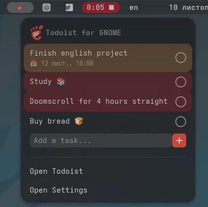
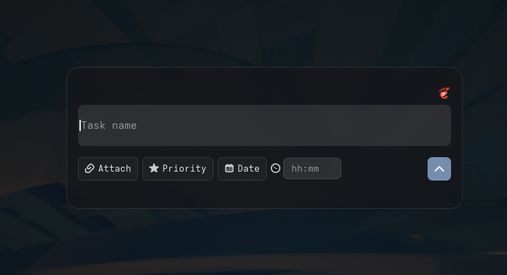

<div align="center">


# Todoist for GNOME
! Not officially supported by Todoist !

**Your Todoist tasks, right in the top panel.**

[](https://extensions.gnome.org/)
[](LICENSE)
[](https://extensions.gnome.org/extension/11070/todoist-for-gnome/)

</div>

---

## Introduction

**Todoist for GNOME** adds a Todoist dropdown to your top panel, so you can check and manage your tasks without opening a browser tab or the desktop app. Also, bind a shortcut, and add tasks even more faster with Todoist style popup window

<div align="center">

| Panel dropdown | Add task popup |
|:---:|:---:|
|  |  |

</div>

## Installation

### GNOME Extensions Website

<a href="https://extensions.gnome.org/extension/11070/todoist-for-gnome/">
  <!-- Button SVG by Just Perfection developer -->
  
</a>

### Manual Installation

You can build and install the extension from a local checkout using the
`gnome-extensions` command.

1. From the repository root, create the ZIP:
   ```bash
   gnome-extensions pack --force --extra-source=images .
   ```
   This creates `todoist-for-gnome@cheapdramas.github.io.shell-extension.zip` in
   the current directory. Use `--out-dir=DIR` to select a different output
   directory. `--extra-source=images` includes the logo used by the extension.

2. Install the ZIP for your user. If you already have the ZIP, start here.
   ```bash
   gnome-extensions install --force todoist-for-gnome@cheapdramas.github.io.shell-extension.zip
   ```
   `--force` allows the command to replace an existing installation with the
   same UUID. GNOME extracts the files to
   `$XDG_DATA_HOME/gnome-shell/extensions/` (usually
   `~/.local/share/gnome-shell/extensions/`).

3. Log out and log back in so GNOME Shell loads the installed files. Then
   enable the extension if needed and check its status:
   ```bash
   gnome-extensions enable todoist-for-gnome@cheapdramas.github.io
   gnome-extensions info todoist-for-gnome@cheapdramas.github.io
   ```

   You can also enable "Todoist for GNOME" in the Extensions app.

## Setup / Settings

### 1. Get your Todoist API token

1. Open Todoist and go to **Settings → Integrations → Developer**.
2. Copy the **API token** shown there.

### 2. Add it to the extension

1. Open **GNOME Extensions** (or run `gnome-extensions prefs todoist-for-gnome@cheapdramas.github.io`).
2. Find **Todoist for GNOME** and open its settings.
3. Paste the token into the **API Token** field.

### 3. (Optional) Pick your Todoist app

In the same settings window, click **Choose...** next to **Todoist Application** and select the Todoist `.desktop` file (native, Flatpak or Snap) — this is what opens when you click on a task. If you skip this, tasks open in your browser instead.

### 4. (Optional) Set a keyboard shortcut

Still in settings, click **Change...** next to **Add Task** and press the key combination you want to use to open the quick "Add task" popup from anywhere.

## Contributing

Issues and pull requests are welcome. If you run into a bug or have an idea for a feature, please open an issue.

## License

[MIT](LICENSE)
